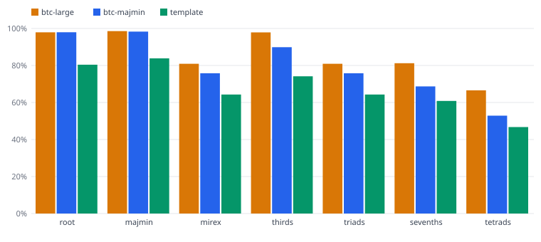

# Chord recognition accuracy — synthetic

4 songs, 1.9 min of annotated audio. Scores are WCSR (duration-weighted chord symbol recall, mir_eval 0.8.2). Real-time factor = processing time / audio length.

| Config | root | majmin | mirex | thirds | triads | sevenths | tetrads | Real-time factor |
|---|---:|---:|---:|---:|---:|---:|---:|---:|
| btc-large | 97.9% | 98.6% | 80.9% | 97.9% | 80.9% | 81.2% | 66.6% | 0.12× |
| btc-majmin | 98.0% | 98.3% | 75.8% | 89.9% | 75.8% | 68.7% | 52.9% | 0.05× |
| template | 80.4% | 83.9% | 64.3% | 74.2% | 64.3% | 60.8% | 46.7% | 0.04× |

- **root** — only the root must match. **majmin** — root + major/minor (the MIREX
  headline metric). **mirex** — at least 3 notes in common. **sevenths/tetrads** — the
  7th (or full chord) must match too.

